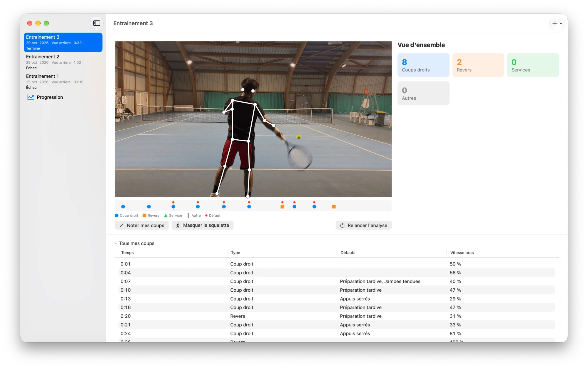

# ACE Vision

Application locale pour Mac qui analyse des vidéos de tennis filmées à l'iPhone. Elle repère chaque coup (coup droit, revers, service), calcule un bilan du match et signale les défauts de technique les plus fréquents avec des conseils. Tout tourne sur votre Mac : rien n'est envoyé sur Internet.



## Installation

1. Téléchargez `ACE-Vision-<version>.zip` depuis la dernière [release](../../releases), ouvrez-le d'un double-clic dans le Finder (ou `ditto -x -k ACE-Vision-<version>.zip .` dans le Terminal ; pas `unzip`, qui casse la signature) et glissez **ACE Vision** dans Applications.
2. L'app n'est pas signée par Apple : la première fois, faites un clic droit sur l'app dans Applications puis **Ouvrir**, ou, une fois l'app dans Applications, dans le Terminal :

```
xattr -dr com.apple.quarantine /Applications/ACE\ Vision.app
```

3. Installez ffmpeg (fournit `ffprobe`) :

```
brew install ffmpeg
```

Au premier lancement, l'app installe le moteur d'analyse et télécharge le modèle de détection (environ 1 Go, connexion Internet nécessaire). Ensuite, tout tourne hors ligne.

Pour reprendre des matchs analysés avec l'ancienne version en ligne de commande, quittez l'app puis lancez depuis le dossier du dépôt :

```
mkdir -p ~/Library/Application\ Support/ACE\ Vision/data/matchs && mv data/matchs/* ~/Library/Application\ Support/ACE\ Vision/data/matchs/
```

## Développement

```
brew install uv xcodegen
uv sync
xcodegen generate --spec app/project.yml
open app/ACEVision.xcodeproj
```

Le schéma `ACEVision` utilise le moteur du dépôt (variable `ACE_REPO`). Pour fabriquer la release : `bash scripts/build_app.sh <version>` (produit `dist/ACE-Vision-<version>.zip`).

Licence : [AGPL-3.0](LICENSE) (imposée par Ultralytics).

## Filmer

- **Vue filet** : iPhone près du filet, tourné vers vous (vous de face, en entier) ; portrait ou paysage, 30 ou 60 images/s.
- **Vue arrière** : iPhone en **paysage**, **60 images/s**, placé **derrière soi, en hauteur** (par exemple au fond du court, sur un point haut).
- Choisissez la vue à l'import ; elle n'est pas détectée automatiquement.

## Assembler plusieurs vidéos d'un match

Un match = une vidéo. Pour en assembler plusieurs, créez `liste.txt` :

```
file 'IMG_0001.mov'
file 'IMG_0002.mov'
file 'IMG_0003.mov'
```

puis :

```
ffmpeg -f concat -safe 0 -i liste.txt -c copy match.mov
```

## Données

Chaque match est copié dans `~/Library/Application Support/ACE Vision/data/matchs/<id>/`. L'app permet de supprimer un match ; importer à nouveau la même vidéo (même nom) remplace la copie et l'analyse précédentes ; si la vidéo a changé, les coups notés sont aussi effacés.

## Calibration

Comparer la détection aux coups notés par le joueur sur un match déjà analysé (réutilise `pose.npz`, pas de YOLO) :

```
ACE_DATA_DIR=~/Library/Application\ Support/ACE\ Vision/data uv run python scripts/calibrate.py <id du match>
```

Le script affiche, note par note, le coup détecté le plus proche (écart, type), les coups manqués, les fausses frappes et le score. Deux notes à moins de 0,3 s d'écart sont comptées comme un seul coup (touche pressée deux fois).

Valeurs retenues (`ace/strokes.py`) :

| Réglage | Valeur | Pourquoi |
|---|---|---|
| `HIT_MIN_SPEED` | 6,0 longueurs de buste/s | même score sur IMG_2665 de 5 à 8 |
| `MIN_HIT_GAP_S` | 1,2 s | la préparation d'un revers donnait une fausse frappe 0,84 s avant l'impact |
| côté du coup | médiane de 0,6 s à 0,1 s avant l'impact, orientation du corps fixe pour la vidéo | à l'impact le poignet traverse déjà vers l'autre côté |
| service | poignet de la raquette au-dessus du sommet du crâne (0,8 longueur de buste au-dessus des épaules) autour de l'impact **et** lancer de balle (autre poignet aussi haut dans les 1,5 s avant) ; bras en l'air sans lancer = `other` | un revers à deux mains finissait poignet au-dessus de la tête |

Plus de règle « deux mains » : sur la vidéo du joueur, les mains restent aussi ensemble pendant la préparation du coup droit (main libre sur le cœur de la raquette) ; le réglage revers à 1 ou 2 mains est donc sans effet sur la détection pour l'instant.

La règle du service n'est validée que sur des services synthétiques et sur une vraie fin de revers bras en l'air (IMG_2665 ne contient pas de service). Relancez l'analyse d'un match pour appliquer la nouvelle règle.

Deux notes à moins de 0,3 s d'écart comptent pour un seul coup, aussi dans le score affiché par l'application.

`THRESHOLDS` (`ace/technique.py`) n'ont pas été recalibrés : les notes du joueur portent sur les coups, pas sur les défauts.

Score sur IMG_2665 (vue filet, droitier, revers à deux mains, 8 coups notés) :

| | Trouvés | Bien classés | Fausses frappes |
|---|---|---|---|
| Avant | 8/8 (100 %) | 1/8 (12 %) | 1 |
| Après | 8/8 (100 %) | 8/8 (100 %) | 0 |

Les huit coups sont trouvés et bien classés, à moins de 0,3 s de la note.

## Calage par le son

Le pic de vitesse du poignet arrive un peu avant ou après l'impact. Chaque frappe est donc recalée sur le claquement balle-cordage le plus proche dans la bande son (montée d'au moins `MIN_RISE_DB` = 12 dB au-dessus de 2 kHz, à `SOUND_SEARCH_S` = 0,1 s au plus du pic du poignet) ; le son ne crée ni ne supprime de frappe.

Pour vérifier à l'image : `uv run python scripts/impact_frames.py <id du match>` écrit `impacts.jpg` dans le dossier du match, une vignette par frappe marquée « son » ou « poignet ». `calibrate.py` affiche aussi le score sans et avec son, la part de frappes calées et le décalage moyen son-poignet.

Mesuré sur deux vidéos vue arrière (2026-10-29) :

| Vidéo | Calées sur le son | Décalage moyen | Vignettes « son » fausses | Score sur les notes (sans son → avec son) |
|---|---|---|---|---|
| echange-3 | 6/10 | 36 ms | 0/6 | pas de notes |
| img-7687 | 10/20 | 43 ms | 1/10 | trouvés 11/14, bien classés 100 %, 9 fausses frappes → identique |

Les frappes restées sur le poignet sont surtout des fausses frappes (joueur qui marche ou se prépare), mais pas seulement : sur img-7687, deux vraies frappes (5,12 s et 58,26 s, balle dans le cordage à l'image) ont leur claquement à 0,19-0,23 s du pic du poignet, hors fenêtre. La vignette « son » fausse (39,39 s) est une fausse frappe du détecteur de pose qui tombe par hasard près d'un claquement.

Les constantes n'ont pas été changées : élargir `SOUND_SEARCH_S` à 0,25 s calerait ces deux vraies frappes (et 41,74 s, joueur hors champ), mais aussi quatre fausses frappes sur un autre bruit : trois sur img-7687 (21,02 s joueur arrêté, 37,64 s joueur qui court, 45,05 s balle qu'il fait rebondir sur la raquette) et une sur echange-3 (24,02 s balle qu'il lance pour servir l'échange).

Limite connue : une vidéo sans son, ou très bruitée, garde l'instant du poignet.

## Tests

```
uv run pytest            # tests rapides
uv run pytest -m slow    # vraies vidéos et modèles
```
